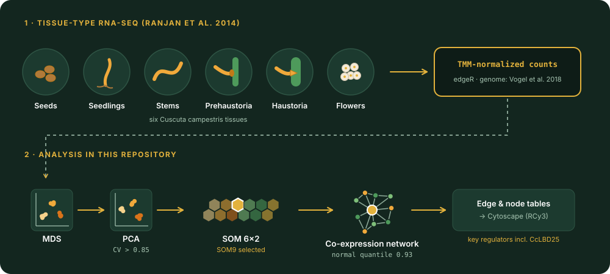

# CcLBD25: haustorium gene co-expression network 

**R notebooks used to identify *CcLBD25* as a key regulator of haustorium development in the parasitic plant *Cuscuta campestris* (dodder)**

This repository contains the transcriptome clustering and gene co-expression network (GCN) analysis for:

> **Jhu M-Y**, Ichihashi Y, Farhi M, Wong C, Sinha NR (2021). LATERAL ORGAN BOUNDARIES DOMAIN 25 functions as a key regulator of haustorium development in dodders. *Plant Physiology* 186: 2093–2110. [doi:10.1093/plphys/kiab231](https://doi.org/10.1093/plphys/kiab231) (preprint: [bioRxiv](https://doi.org/10.1101/2021.01.04.425251))

Gene expression across six *C. campestris* tissues was clustered with MDS, PCA and a self-organizing map (SOM). SOM9, the cluster enriched with genes highly expressed in both prehaustoria and haustoria, was used to build a gene co-expression network, which highlighted the transcription factor *CcLBD25* for functional study.

  

## Analysis steps

Run the notebooks in this order; each one reads files written by the previous step.

| Step | Notebook | What it does |
|---|---|---|
| 1 | `MDS_dodder_updated.Rmd` | Filters low-count genes, normalizes with edgeR, and plots an MDS of all libraries |
| 2 | `PCA_dodder_updated.Rmd` | Averages each tissue, keeps genes with coefficient of variation > 0.85, and runs PCA |
| 3 | `SOM_dodder_updated.Rmd` | Clusters genes with a 6 × 2 hexagonal SOM (`kohonen`, seed set) on PCA scores |
| 4 | `gene coexpression network updated.Rmd` | Builds a weighted co-expression network for SOM9 genes (Pearson correlation, Fisher *z*, normal quantile cutoff 0.93) and exports edge and node tables for Cytoscape |

Step 4 uses [`RSMod`](https://github.com/MinYaoJhu/RSMod) for normalization and `igraph` for the network; the final `RCy3` call sends the network to a running Cytoscape session for visualization.

## Data

The input count tables (`TMM-Counts-all-Libraries-Table_organized.csv` and `SOM9_all_Cc_tissue_ID_ex.csv`) are not included in this repository.

- **Tissue-type RNA-seq:** seeds, seedlings, stems, prehaustoria, haustoria and flowers from Ranjan A, Ichihashi Y, Farhi M, *et al.* (2014). De novo assembly and characterization of the transcriptome of the parasitic weed dodder identifies genes associated with plant parasitism. *Plant Physiology* 166: 1186–1199. [doi:10.1104/pp.113.234864](https://doi.org/10.1104/pp.113.234864) (species reported as *C. pentagona*, = *C. campestris*). Reads were mapped with Bowtie 2 to the *C. campestris* genome (Vogel *et al.* 2018) and TMM-normalized with edgeR.
- **LCM RNA-seq** of the haustorial interface (also used in the paper): NCBI BioProject [PRJNA687611](https://www.ncbi.nlm.nih.gov/bioproject/PRJNA687611); analysis code in [Cuscuta_LCM_project](https://github.com/MinYaoJhu/Cuscuta_LCM_project).

## Requirements

R with `edgeR`, `limma`, `ggplot2`, `reshape`, `kohonen`, `MASS`, `class`, `gplots`, `RColorBrewer`, `igraph`, [`RSMod`](https://github.com/MinYaoJhu/RSMod) and, for the optional Cytoscape export, `RCy3` with Cytoscape running. The original analysis was run in 2019–2020. A tested environment for the closely related MDS, PCA and SOM steps is available in [Cuscuta_LCM_project](https://github.com/MinYaoJhu/Cuscuta_LCM_project/blob/main/environment.yml).

## Related repositories

- [Cuscuta_LCM_project](https://github.com/MinYaoJhu/Cuscuta_LCM_project): laser capture microdissection RNA-seq of the *Cuscuta*–tomato haustorial interface (Jhu *et al.* 2022, *Frontiers in Plant Science*)
- [gene-coexpression-network-script](https://github.com/Hokuto-GH/gene-coexpression-network-script): Hokuto Nakayama's original co-expression network script, adapted in step 4

## Citation

If you use this code, please cite the article above and the archived code: Jhu M-Y (2026). *CcLBD25: haustorium gene co-expression network analysis in Cuscuta campestris* (v1.0.0). Zenodo. [doi:10.5281/zenodo.24096944](https://doi.org/10.5281/zenodo.24096944). GitHub's **"Cite this repository"** button (from [`CITATION.cff`](CITATION.cff)) gives the citation in APA and BibTeX formats.

## License

MIT License (see [`LICENSE`](LICENSE) and [`NOTICE.md`](NOTICE.md)), except that `gene coexpression network updated.Rmd` is adapted from Hokuto Nakayama's script, which has no stated license; please credit his original work when reusing that file.

## AI assistance

Documentation and figures in this repository were updated with the assistance of Claude Opus 5.5 (Anthropic), used through Claude Code. The original analysis code was written by Min-Yao Jhu, with contributions from co-authors credited in each notebook. All changes were directed, reviewed and approved by the author, who takes full responsibility for the content.

## Contact

**Min-Yao Jhu**, Senior Research Scientist, Donald Danforth Plant Science Center
Email: [MJhu@danforthcenter.org](mailto:MJhu@danforthcenter.org) · Website: [minyaojhu.com](https://www.minyaojhu.com)
